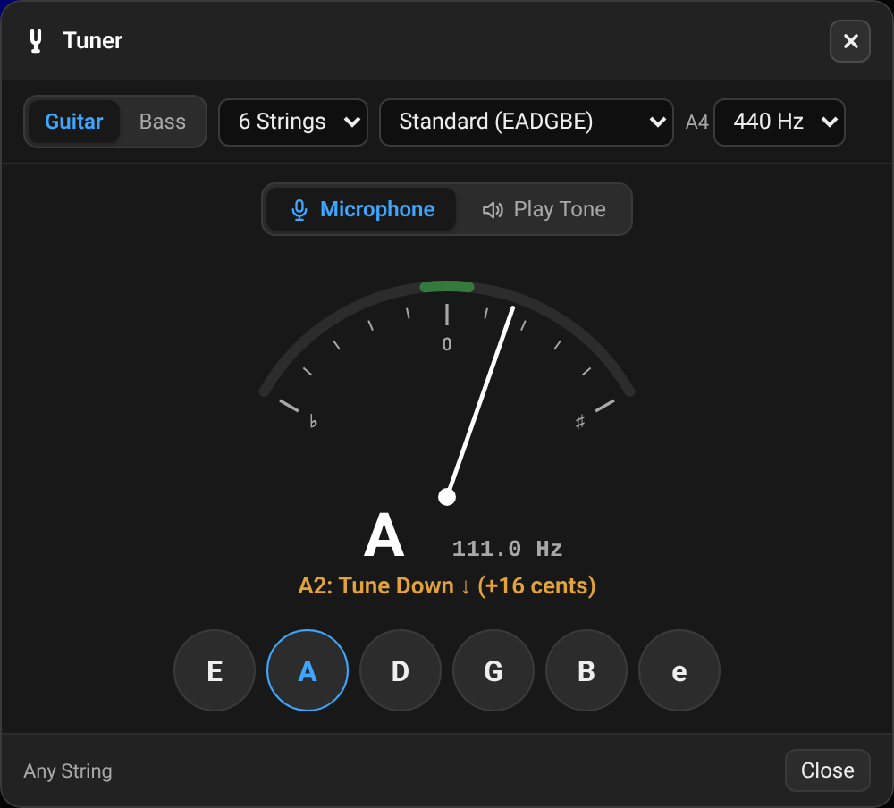
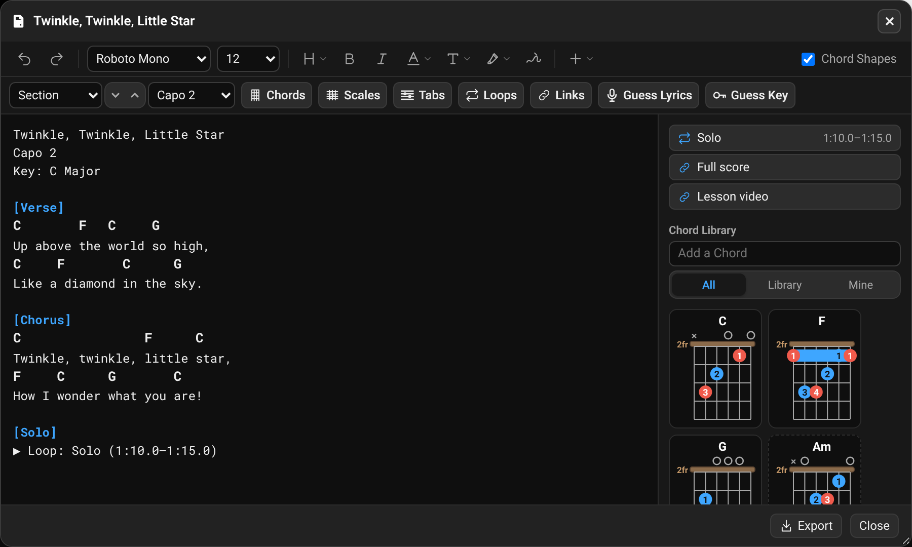
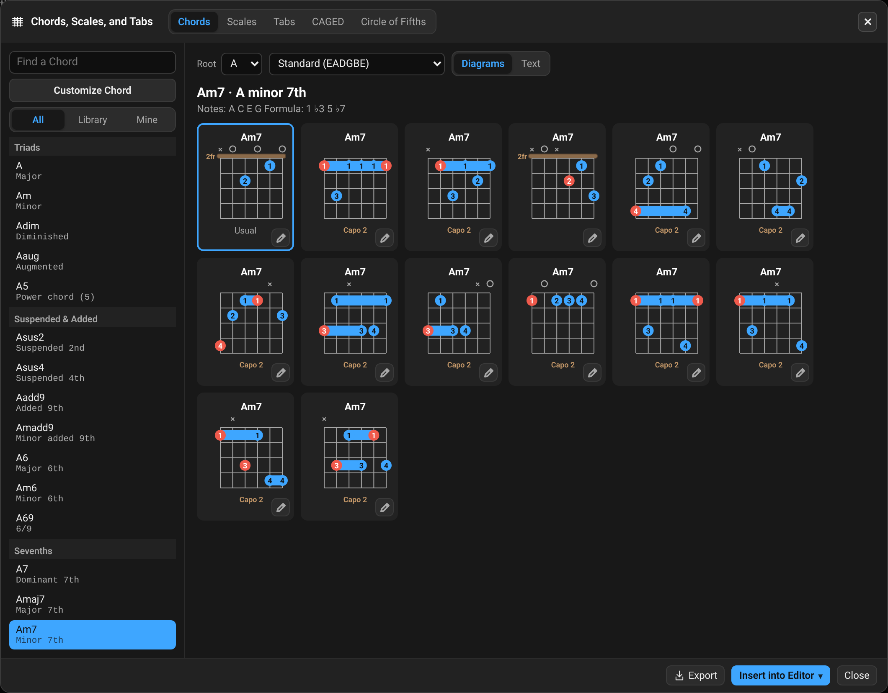
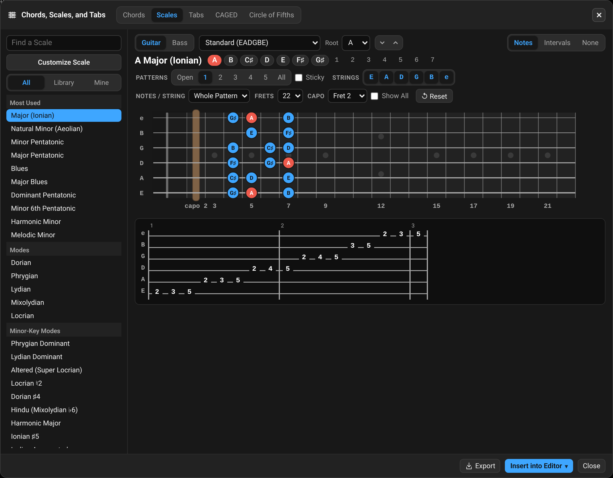
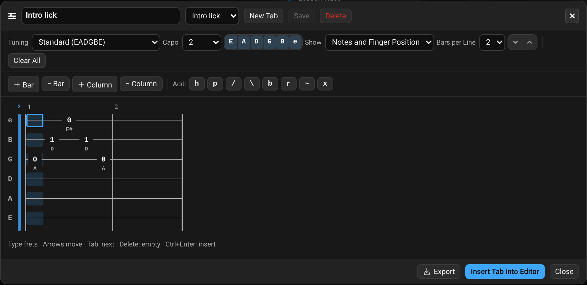
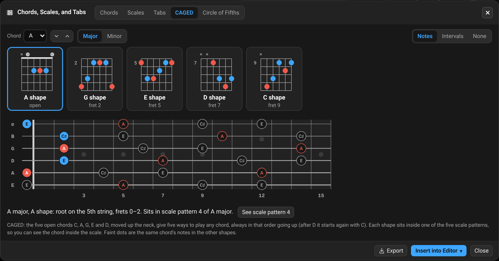
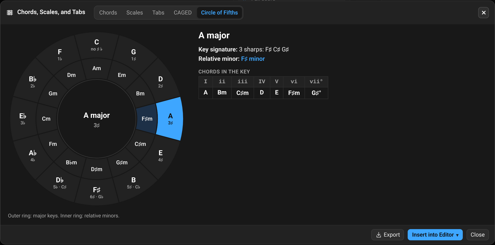
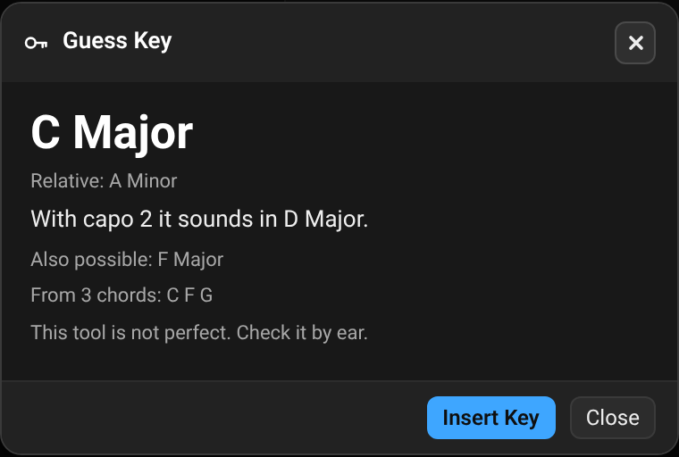
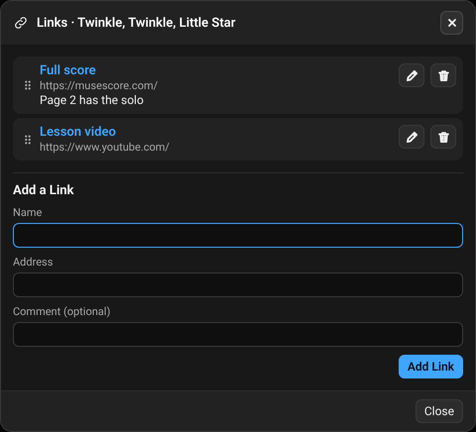
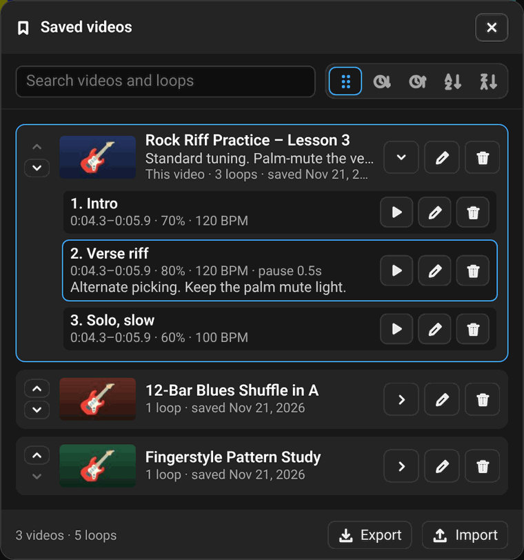

  

<h1 align="center">YouTube Guitar Playa Companion</h1>

  <b>Learn any song from YouTube.</b> 
  A free Chrome extension for guitar and bass players, right next to the video.

> [!WARNING]
> For private, personal use. Experimental and not supported. Use at your own risk. Provided as is, with no warranty; it may stop working when YouTube changes its website. Not published in the Chrome Web Store.

## Features

- **A–B looping**, fine-tuned to a tenth of a second, with a pause between repeats
- **Slow down or speed up** (25%–500%) without changing the pitch, plus a speed trainer
- **Saved loops and videos**, saved when you choose to (the disk beside the video's name), sorted and searchable, exported and imported in one `.gpyc` file
- **Metronome** with tap tempo, accents and **Auto BPM** that finds the tempo
- **Tuner** for guitar (6 or 7 strings) or bass (4 or 5): listen through the microphone, or play each string's note
- **Editor** for each video: chords over the words, formatting, colours, pictures and drawing
- **Chord Library** beside the page: the song's chords, plus any you add
- **Transpose, capo and Guess Key** (with the key signature drawn on a staff), **chord fingerings when you point at a chord**, and **Guess Lyrics** from the video's captions
- **Tabs**: a tab editor with capo, notes view and a collection kept for every video
- **Chords, Scales, and Tabs**: every chord type, 51 scales, CAGED and the circle of fifths, on guitar, 7-string or bass
- **30+ tunings** (Standard & Drop, Open, 7-string, bass), or tune any string yourself
- **Customize** your own chords and scales; the library ones are never changed
- **PDF, print and text export**, with chord shapes and fretboards drawn in letters
- **Links** to scores and lessons, kept with each video
- Day, Night or System theme. Everything stays in your browser.

## Screenshots

  
  
  

  

  
  

  

  
  

  
  
  

## Why

Learning a song from a video means rewinding the same five seconds over and over. Guitar Playa Companion loops the part you're working on, slows it down so you can hear every note, keeps time with a metronome, and keeps your chords, tab and notes with the video, so it's all there next time.

## Install

Works in Chrome 111+ and other Chromium browsers (Edge, Brave).

1. `git clone https://github.com/johnlwhiteman/guitar-playa-youtube-companion.git` (or **Code → Download ZIP** and unzip).
2. Open `chrome://extensions` and turn on **Developer mode**.
3. Click **Load unpacked** and pick the folder with `manifest.json`.
4. Pin the maneki-neko to the toolbar.

To update: `git pull`, then click ↻ on the extension in `chrome://extensions` and refresh YouTube. Keep only one copy installed, and don't remove it to update: removing it deletes your saved data (download everything first).

## How to Use

<!-- This section, Troubleshooting and Privacy are the same as the Help (?) inside the extension. -->

### Quick Start

1. Open a YouTube video and click the cat in the toolbar.
2. Click **Set A** where the part starts and **Set B** where it ends. It starts looping.
3. Lower the **Speed**. The pitch stays the same.
4. Click **Save Loop** to keep it. Saving a loop saves the video too.

### Loops

- Fine-tune A and B with − and + (hold Shift for 1 second), or type a time such as `1:23.4`.
- **Loop** turns looping on or off. **Clear** removes A and B.
- **Speed** goes from 25% to 500% without changing the pitch.
- **Pause Between Loops** waits before each repeat. **Change Speed Each Loop** gets a little faster every time.

- A video can have many loops. Pick one from the list. Drag to reorder, ✎ to edit, 🗑 to delete.
- **＋** starts a new loop.

### Saved Videos

- The list button at the top shows your saved videos and their loops. The list next to the search box sorts them: My Order, Newest First, Oldest First, Name A–Z or Z–A.
- **Export** (the down arrow at the top) saves everything in one .gpyc file (Chrome asks where to save it and what to call it; the .gpyc ending is kept); **Import** (the up arrow) brings it back.
- The list next to **Save Loop** shows the video’s name and its loops. ✎ renames the video: type the name, then press Enter or click the disk to save it (an unsaved video is saved with that name). When the video or its first loop isn’t saved yet, the list has a **Save** button.
- A video is only saved when you save it. The disk left of the video’s name saves it (saving a loop saves it too). Once it’s saved, the disk turns into a bin: click it twice to delete the video with its loops, page and links. Writing in the **Editor** or adding a link also saves the video, so your work isn’t lost.

### Editor

- **Editor** (or `N`) opens a page for the video. A new page starts with the video’s title as a heading (H1), with the cursor on the line under it. Put the chords on the line above the words. It saves as you type.
- The top row formats text: font, size, headings, **bold**, *italic*, superscript, subscript, text colour, highlight colours, lists, links and tables. With text selected, only that text changes. Font and size with nothing selected change the whole page. The formatting shows as you type. The styles menu also has **Upper Case** and **Lower Case** for the selection, or the whole page when nothing is selected (chord lines are left alone). **Text Colour** with nothing selected colours the whole page; **Default Colour** takes it off.
- **＋ → Picture** adds an image; you can also paste or drop one into the page. Backspace after it removes it.
- The squiggle button lets you draw on the page with a pencil, pen, old ink pen, marker or chalk, in any colour and size. Smear softens what’s under it; the eraser removes a line. **Done**, or clicking the chosen tool again, goes back to typing.
- The **Section** list adds [Verse], [Chorus] and so on. The **↓ ↑** arrows (Transpose) move every chord down or up a half step. The buttons after them are **Chords**, **Scales**, **Tabs**, **Loops**, **Links** and **Guess** (a menu: **Lyrics** or **Key**). In a narrow editor these buttons show just their icons.
- The **Chord Library** on the right shows the song’s chords. The side-panel button just right of **＋** (Show / Hide Chord Shapes) shows or hides that whole side; hiding it makes the editor window narrower so more of the video shows, and showing it widens it again. Type in **Add a Chord** to add others that aren’t in the words yet (All · Library · Mine filters both the choices and the chords already in the library; Mine is your own chords. Chords already in the library aren’t offered again); × removes one. They move with the arrows and go into the PDF. Click a chord shape to change it: click a fret to add a finger, click again to number it, and once more to remove it.
- **Tabs**: click a string and type the fret. Name a tab and **Save** it to keep it for every video; pick it again from the list, change it or **Delete** it. **Save** turns on once the tab has a name and something changed. **New Tab** starts an empty one; **Export** makes a PDF, prints it or saves it as a text file; **Close** leaves without adding anything. Frets go from 0 to 24. **Capo** shows where the capo sits beside the strings; click string names to leave some strings out (a partial capo). **Show**: Finger Position (frets), Notes, or both. **Insert Tab into Editor** adds it with its name and capo.
- **Guess → Lyrics** reads the lyrics from the video’s closed captions or subtitles and adds them at the cursor, one verse after another. Lyrics in capitals are turned into lower case (with a capital at the start of each line). **Include Timestamps** puts a time like [0:12] at the start of each verse; it’s off unless you turn it on. It checks first: if the video has captions, finding the lyrics is likely; if it has none, it says so. Captions written by people are used first. It’s not perfect: check the words.
- **Guess → Key** looks at the chords in the page and names the likeliest key, its relative key, other possible keys and, with a capo, the key it sounds in. **Insert Key** puts a “Key: G Major” line under the title, and **Scales** then opens in that key. A key line near the top shows the start of a score beside it: the treble clef with the key’s sharps or flats (also in the PDF).
- **Capo** (next to the arrows) puts a “Capo 3” line under the title; the chord shapes, the scales and the PDF follow it. Chord shapes show the capo the usual way: a bar in place of the nut with its fret beside it (“3fr”), and the chord shape is played from the capo. With no capo line it shows **No Capo**.
- Point at a chord in the page for a moment and its fingering pops up (with the capo, if there is one).
- **Loops** adds one of your loops to the page. **Links** keeps links to scores, tabs and lessons (also the link button next to Tabs on the main panel). Click a link’s name or its full address to open it in its own window.
- Ctrl+click (⌘+click on a Mac) a loop, a time or a web address in the page to use it.
- At the bottom: **Export** (a text file with plain words and no formatting, a PDF or print, with or without chords and links) and **Close** (or × at the top). The PDF keeps the colours, highlights and drawings.

### Chords, Scales, and Tabs

- **Scales**: 51 scales for guitar (6 or 7 strings) or bass (4 or 5 strings), in any key and tuning (Standard & Drop, Open and more). Click a string’s letter beside the fretboard to tune that string; the tab follows. In the tab each pattern starts its own line, three measures to a line. Red dots are the root. The key signature the scale is written in shows to the right of the pattern rows (a mode uses its parent key: D Dorian is written like C major). The button left of the Chords tab hides the list on the left (on Chords, Scales and Tabs), which makes the window narrower; click it again to bring the list back.
- **Customize Scale** shows every note of the chosen scale on the neck. Click a note to turn it on or off, or a string name for the whole string; **Reset** goes back to what was showing. Name it and save it: it’s in the list under My Scales, in any key (All · Library · Mine filters the list). Library scales are never changed. ✎ edits or deletes it.
- **Chords**: every chord type (major to 13ths) in any key, with several shapes to play each, on guitar, 7-string guitar or bass (the list next to Root). **Diagrams** or **Text** shows the fingerings as pictures or in letters. Type a chord (Am7, Gsus4 …) in the search box to find it. ✎ on a shape changes it and makes it the one your songs show. **Customize Chord** starts from the chosen shape: change it, give it a one-word name, and use that name in your songs. It starts with the name “Am7__Custom” (for an Am7), keeps the red roots of the chord it came from, and goes into the chord library under My Chords; your song is not changed. All · Library · Mine filters the list. Library chords are never changed.
- **Tabs** (after Scales; CAGED and Circle of Fifths come next): every tab you saved, for any video. With none saved yet, Tabs goes straight to a new tab. Pick one to see it; **Edit**, **Delete**, **New Tab**, **Export**, or **Insert into Editor**.
- **CAGED**: the five shapes of a chord. **Circle of Fifths**: keys and their chords.
- **Insert into Editor ▾** adds what you see to the page at the cursor (at the end of the page if you haven’t clicked in it, or if the editor isn’t open: it opens this video’s page), **As Text** (tab, chord name, key) or **As Image** (a picture of the fretboard, chord shape, tab, CAGED neck or circle). **Export** makes a PDF, prints it, or saves a text file with the chord shapes and the fretboard drawn in letters.

### Metronome

- **Start** the click. Set the speed with − and +, the slider or **Tap**.
- **Auto BPM**: the cat listens to the video and finds the tempo.
- The metronome starts hidden. The metronome button at the top shows or hides it. The round arrow beside **Metronome** folds its controls away (**Show** / **Hide**).

### Tuner

- The tuning-fork button at the top opens the tuner, for guitar (6 or 7 strings) or bass (4 or 5 strings) in any tuning, with A4 from 430 to 450 Hz.
- **Microphone** listens through your microphone (Chrome asks the first time) and pauses the video. Play a string: the needle and the note show how far off it is; **Tune Up** or **Tune Down** until it says **In Tune**. It finds the string by itself, or click a string to tune only that one.
- **Play Tone** plays each string’s note when you click it: **Pluck** (plucked again and again) or **Constant** (a steady tone). Click the string again to stop. Bass notes play as loud as guitar notes. **Volume** sets how loud.

### Buttons at the Top

Saved videos · import · export · tuner · metronome · theme · help · close. Under them, next to the time: **Editor**, **Chords**, **Scales**, **Tabs** and **Links**. The panel opens at the upper right, beside the video rather than over it; drag the title bar to move it.

### Keyboard Shortcuts

| Key | Action |
|---|---|
| `[` / `]` | Set A / set B |
| `\` | Loop on/off |
| `;` | Jump to A |
| `Backspace` | Clear the loop |
| `-` / `=` | Speed down / up 5% |
| `N` | Editor for this video |
| `Esc` | Close a pop-up |

## Troubleshooting

- **The speed won’t change, or a red warning appears**: another copy of this extension, or another speed extension (like Video Speed Controller), is fighting over the video. Keep one, then refresh.
- **No panel**: click the toolbar icon on a YouTube tab. Just installed or updated? Refresh the tab.
- **Auto BPM hears nothing**: the video has to be playing and not muted.
- **The tuner hears nothing**: allow the microphone for youtube.com (the icon at the right of the address bar), or use **Play Tone**.
- **Start over**: **Reset to Default…** at the bottom of the Help window. **Reset Settings** puts the theme, panel, speed, metronome and other choices back and keeps your saved work; **Erase Everything** also deletes every saved video, loop, page, tab and your own chords and scales (**Export First** keeps a copy).

## Privacy

Nothing leaves your computer. No accounts, no analytics, no tracking. Your settings, saved videos, loops, pages and links are kept in the browser’s local extension storage. Auto BPM and the tuner analyse the sound inside your browser; the microphone is only used while the tuner is listening. Permissions: `storage`, `unlimitedStorage` (for pictures in your pages) and `scripting`, on `youtube.com` only.

## Citation

See [`CITATION.cff`](CITATION.cff), or **Cite this repository** on GitHub.

## License

[MIT](LICENSE). Roboto Mono is included under the [SIL Open Font License](fonts/OFL-RobotoMono.txt).

Not affiliated with YouTube or Google. "YouTube" is a trademark of Google LLC.
