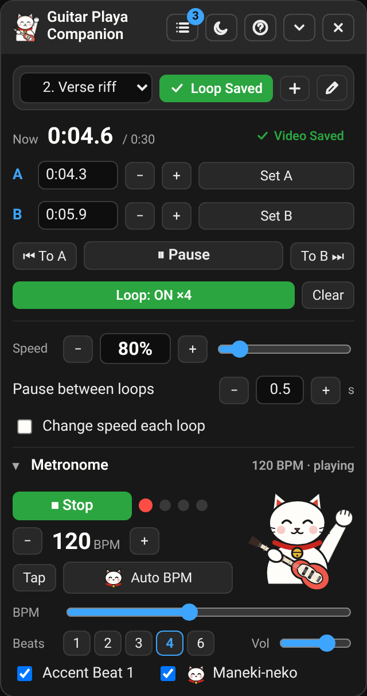
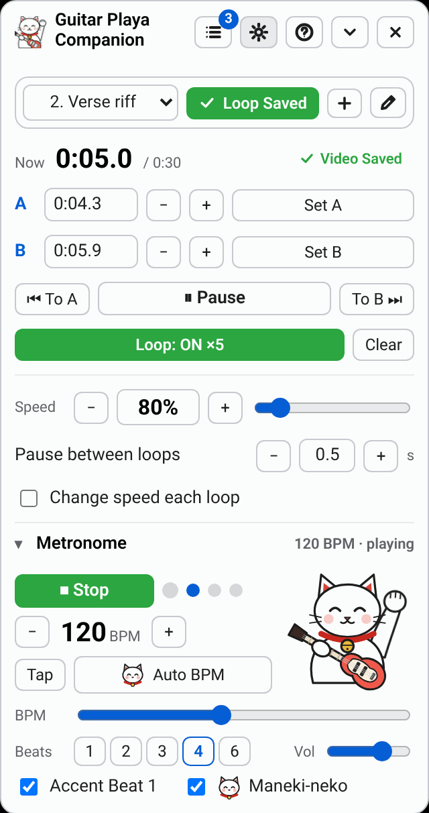
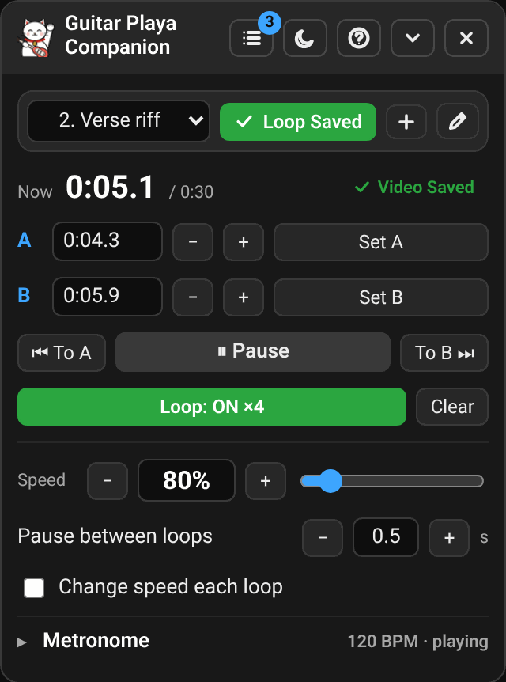
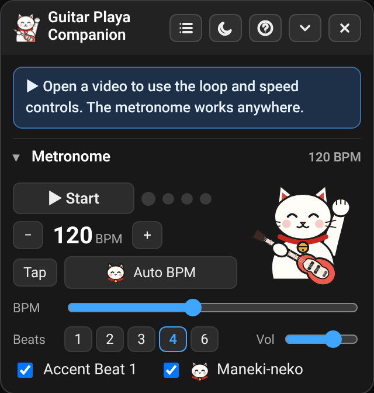
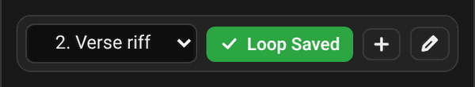
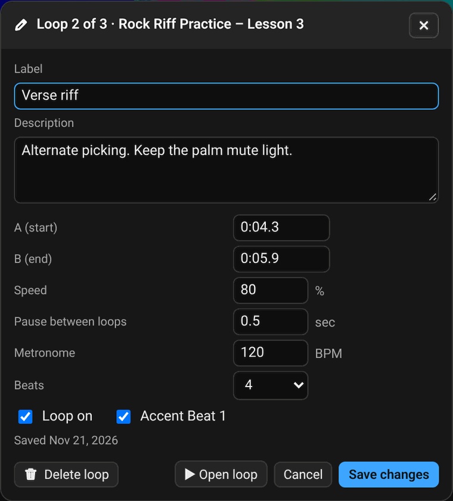
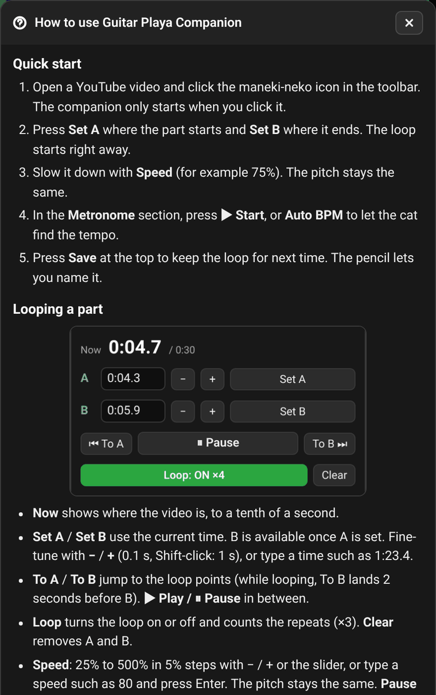

  

<h1 align="center">YouTube Guitar Playa Companion</h1>

  <b>Loop the hard parts, slow them down without changing the pitch, and lock in with a metronome. 
  Learn any song on YouTube at your own pace.</b>

> [!WARNING]
> For private, personal use. Experimental and not supported. Use at your own risk. It is provided as is, with no warranty, and it may stop working when YouTube changes its website. It is not published in the Chrome Web Store or on Firefox Add-ons.

  
  &nbsp;&nbsp;
  

## Features

- **A/B loop:** set a start and end point while the video plays, fine-tune them, and loop that part with an optional pause between repeats. The Loop button counts the repeats.
- **Speed trainer:** change the speed a little on every repeat (e.g. +5% per loop up to 100%).
- **Speed without pitch change:** 25%–500%, and you can type a speed.
- **Metronome:** BPM, Tap, and **Auto BPM**, where the cat listens to the video, sets the tempo and starts the metronome. It restarts on beat 1 every time the loop starts over.
- **Maneki-neko:** the guitar-playing lucky cat waves on every beat.
- **Saved videos and loops:** save a video (with or without loops) and any number of loops per video, each with its own speed and metronome settings. Search, sort, edit, reorder and delete them later, and export them to a file or import them from one (duplicates are skipped).
- **Compact panel:** a one-row loop bar, and a metronome section you can fold away.
- **Day, Night or System theme** (Night by default), built-in **Help**, keyboard shortcuts.
- **YouTube only:** on every other site the toolbar icon is greyed out.

## Install

Requires Google Chrome 111 or newer, or another Chromium-based browser such as Edge or Brave.

1. Get the code: either `git clone` this repository, or use **Code → Download ZIP** and unzip it. Keep the folder; the browser loads the extension from it.
2. Open `chrome://extensions` (Edge: `edge://extensions`, Brave: `brave://extensions`).
3. Turn on **Developer mode** (top-right switch).
4. Click **Load unpacked** and select the folder that contains `manifest.json`.
5. Pin the extension to the toolbar (puzzle-piece menu → pin). Its icon is a maneki-neko with a guitar. It is greyed out on sites other than YouTube.

### Update

1. `git pull` (or replace the files in the **same** folder with the new ones).
2. In `chrome://extensions`, click the reload ↻ arrow on the extension's card.
3. Refresh any open YouTube tabs.

> [!IMPORTANT]
> Keep only **one** copy installed. Every *Load unpacked* of a different folder adds another copy, and copies fight over the video speed. Removing the extension also deletes your saved videos, so update in place instead of removing and re-adding.

## How to use

Click the maneki-neko icon in the toolbar on a YouTube page to start the companion. It does nothing until you click it: no panel, and no changes to the video. On other sites the icon is greyed out.

  
  &nbsp;&nbsp;
  

From top to bottom:

| Part | What it does |
|---|---|
| **Title bar** | List: your saved videos · moon: theme (Night, System, Day) · **?**: help · chevron: minimize · **✕**: exit (stops everything and sets the video back to normal speed). Drag it to move the panel |
| **Loop bar** | Save the video and its loops, in one row (see below) |
| **Now** | Where the video is, to a tenth of a second. **Save Video** on the right saves the video before any loop (then shows **✓ Video Saved**) |
| **A / B** | **Set A** / **Set B** use the current time; **−** / **+** fine-tune by 0.1 s (Shift-click: 1 s), or type a time like `1:23.4`. B is available once A is set. Setting B starts the loop |
| **To A · Play · To B** | Jump to A, play/pause, jump to B (while looping, 2 s before B) |
| **Loop / Clear** | Loop on or off (it counts the repeats, e.g. ×3). Clear removes A and B; if a saved loop is selected, it's removed from the list too |
| **Speed** | 25% to 500% in 5% steps with − / + or the slider, or type a speed such as `80` and press Enter. The pitch stays the same |
| **Pause between loops** | Seconds of silence before each repeat (− / +) |
| **Change speed each loop** | Tick it to speed up (or slow down) a little on every repeat: choose the change per loop, e.g. **+5%** or **-5%**, and the speed to stop at, e.g. **100%**. When it gets there, the loop carries on at that speed. **↺** goes back to the starting speed; untick to turn it off |
| **Metronome** | The last section. While looping, it restarts on beat 1 each time the video jumps back to A (with a pause between loops, it keeps counting during the pause and restarts when the video does). Click its title to fold it away or open it; folded, it still shows the BPM and whether it's playing. Inside: **▶ Start**, − / + BPM, **Tap**, **Auto BPM** (the cat listens, sets the BPM and starts the metronome), a BPM slider, beats per bar, volume, **Accent Beat 1** and **Maneki-neko** (show the cat, whose paw comes down on every beat) |

  
  &nbsp;&nbsp;
  

Before you open a video, the panel shows just the metronome. The chevron in the title bar folds the whole panel down to its title bar.

### Saving videos and loops

A saved video can have **no loops or many loops**. Each loop keeps its own A/B points, loop on/off, speed, pause between loops and metronome settings (BPM, beats, accent).

  

| Control | What it does |
|---|---|
| Loop list | Once the video is saved: the **video** at the top, with its saved loops under it in time order (earliest first). Pick a loop to load its settings, or pick the video to start a new loop (the current loop stops). Empty until the video is saved |
| **Save Loop** | Saves the loop once A and B are set: into the selected loop (overwriting it), or as a new loop if none is selected. Saving a loop also saves its video. Turns green, **✓ Loop Saved**, while nothing has changed |
| **Save Video** (next to the time) | Saves the video on its own, before any loop. Once the video is saved it shows **✓ Video Saved** and is disabled |
| **＋** | Adds the current settings as a new loop. New loops are named "Loop 1", "Loop 2"…; edit them with the pencil. Adding a new loop stops the current one playing, so you can move on to the next part |
| **Pencil** | Opens the loop editor: rename, describe, change settings, or delete (one click) |

### Loop editor

Edit a loop's **label** and **description** (e.g. fingering or what to focus on), and its **A / B**, **Loop on**, **Speed**, **Pause between loops**, **BPM**, **Beats** and **Accent Beat 1**. **Save changes** updates it; if it's the loop you're playing, the panel picks up the changes right away. **▶ Open loop** plays it; **Delete loop** removes it with one click.

  

### Saved videos

The **list** button in the title bar (with the number of saved videos) opens your list, from any YouTube page. If the video you're watching isn't saved yet, a **＋ Save this video** card at the top saves it. Opening a video from the list starts the companion on that video.

- **Search** finds videos by title, description or loop name as you type.
- **Sort icons:** your own order, newest first, oldest first, A–Z, Z–A.

- **Click a video** to open it. The **arrow** shows its loops: **click a loop** to edit it, or **▶** to play it.
- **▲ / ▼** rearrange videos. A video's loops are always in time order.
- The **pencil** edits a video's title and description.
- The **bin** deletes straight away: a loop, or a whole video with its loops.
- In **your own order** (the first sort icon), newly saved videos go to the top and ▲ / ▼ rearrange them.

**Export and import** (at the bottom of the list):

- **Export** saves all your saved videos and loops to a file (`guitar-playa-companion-YYYY-MM-DD.json`). Use it as a backup, or to move your list to another computer or browser profile.
- **Import** adds the saved videos from one or more exported files; you can pick several files at once. Nothing you already have is replaced.
- **Duplicates are skipped.** Every saved video and every loop has its own unique ID, which goes into the file. A video you already have only gets the loops it's missing, and importing the same file twice adds nothing. The message tells you what happened, e.g. "Imported 1 video and 2 loops, skipped 3 duplicates".

  

### Help

The **?** button opens a short guide with pictures.

  

### Keyboard shortcuts

| Key | Action |
|---|---|
| `[` / `]` | Set A / set B |
| `\` | Loop on/off |
| `;` | Jump to A |
| `Backspace` | Clear the loop |
| `-` / `=` | Speed down / up 5% |
| `Esc` | Close a pop-up |

Shortcuts work once the companion is started (toolbar icon). They are ignored while you type in a text field, and they also work in full screen.

## Troubleshooting

**The speed doesn't change, or a red warning appears in the panel**

- **Another copy of the companion is installed.** Open `chrome://extensions` (or click **Open extensions page** in the warning), keep one copy, remove the rest, and refresh the YouTube tab.
- **Another extension changes the video speed,** such as Enhancer for YouTube or Video Speed Controller. Turn it off for YouTube, or stop it from setting the speed, then refresh.

**The panel doesn't appear:** click the toolbar icon on a YouTube tab. If the icon is greyed out, you're not on YouTube. If the extension was just installed or reloaded, refresh the tab.

**Auto BPM can't hear anything:** the video must be playing and not muted.

## Privacy

No private data is saved. The extension has no accounts, no analytics and no tracking, and it sends nothing anywhere.

The only things it stores are your practice settings, in Chrome's local extension storage on your own computer: panel position, theme, metronome settings, the last loop points and speed for each video you've practiced with (by video ID), and your saved videos (video ID, your title and description, the video's title, and for each saved loop its label, description, loop points, speed, pause and metronome settings; a video can also be saved with no loops). Saved-video thumbnails are loaded from YouTube's own image server, as on any YouTube page. Auto BPM analyses the video's sound inside your browser only. Removing the extension deletes all of this, so export your saved videos first if you want to keep them. An exported file is saved only where you choose and contains only your saved videos and loops.

## How it works

| File | Purpose |
|---|---|
| `manifest.json` | Extension manifest (Manifest V3). It runs only on `youtube.com`, and its permissions are `storage` and `scripting` |
| `content.js` | The panel, looping, metronome, auto BPM, saved loops and saved videos |
| `page-bridge.js` | Runs in the YouTube page itself and holds the video at the companion's speed, because YouTube keeps resetting the speed and only accepts its own preset values |
| `background.js` | Toolbar icon: enabled only on YouTube tabs; a click opens the panel, adding it to tabs that were open before the extension was installed |
| `icons/` | Extension icons |
| `help/` | Pictures shown in the in-app Help |
| `docs/screenshots/` | Images for this README |

The screenshots were taken on a local test page, not on YouTube itself.

## License

[MIT](LICENSE). For private, personal use as described in the warning above; provided as is, with no warranty.

## Disclaimer

This project is not affiliated with, endorsed by or connected to YouTube or Google. "YouTube" is a trademark of Google LLC.
